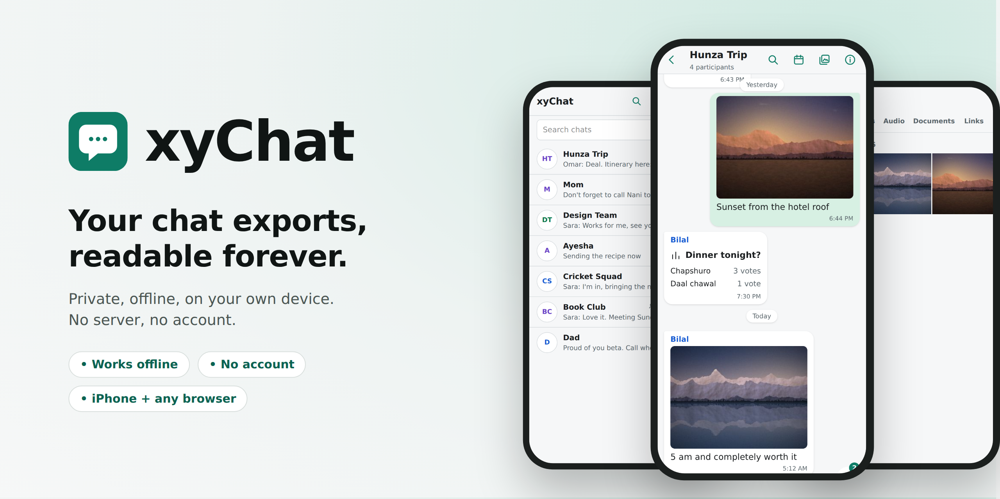
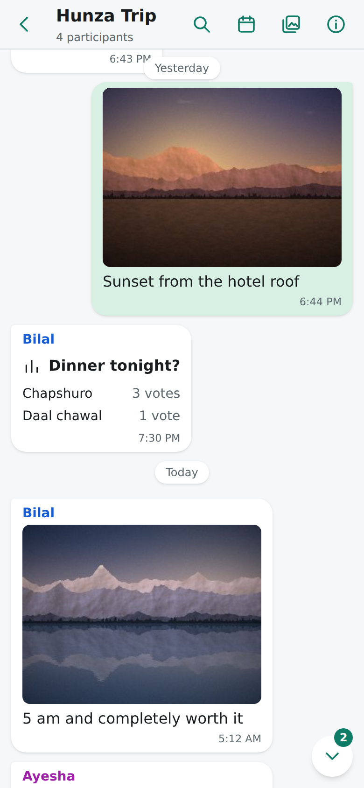
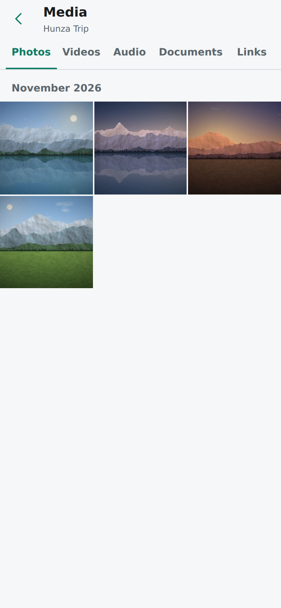

<p align="center">
  <a href="https://hamza-kakar.github.io/xyChat/">
    <picture>
      <source media="(prefers-color-scheme: dark)" srcset="docs/banner-dark.png">
      
    </picture>
  </a>
</p>

<p align="center">
  <a href="https://github.com/hamza-kakar/xyChat/actions/workflows/ci.yml"></a>
  <a href="https://github.com/hamza-kakar/xyChat/releases/latest"></a>
  <a href="LICENSE"></a>
  
  
  
</p>

<h3 align="center">
  <a href="https://hamza-kakar.github.io/xyChat/">Open xyChat</a> ·
  <a href="#try-it-in-30-seconds">Try the demo</a> ·
  <a href="#install-on-iphone">Install</a> ·
  <a href="#privacy">Privacy</a> ·
  <a href="#help">Help</a>
</h3>

xyChat opens the files WhatsApp's **Export Chat** creates and shows them the
way you remember them: bubbles, photos, voice notes, search and more, even
years later and in airplane mode.

There is no server and no account. The database, media and search index live
in your browser's private storage. **Your chats never leave your device.**

## Why xyChat?

An exported chat is a giant `.txt` file and a folder of loose media. xyChat
turns it back into a conversation.

|                                       | Raw export (`.txt` + files) | xyChat |
| ------------------------------------- | :-------------------------: | :----: |
| Chat bubbles, day separators          |              –              |   ✓    |
| Photos and videos inline              |              –              |   ✓    |
| Voice notes (incl. `.opus` on iPhone) |              –              |   ✓    |
| Fast search in any script             |              –              |   ✓    |
| Jump to a date, bookmarks             |              –              |   ✓    |
| Works offline, no account             |              ✓              |   ✓    |

## Screenshots

<div align="center">
<table>
  <tr>
    <td align="center">
      <picture>
        <source media="(prefers-color-scheme: dark)" srcset="docs/screenshots/readme/chats-dark.png">
        
      </picture>
      <br><sub><b>Chat list</b></sub>
    </td>
    <td align="center">
      <picture>
        <source media="(prefers-color-scheme: dark)" srcset="docs/screenshots/readme/chat-dark.png">
        
      </picture>
      <br><sub><b>Chat view</b></sub>
    </td>
    <td align="center">
      <picture>
        <source media="(prefers-color-scheme: dark)" srcset="docs/screenshots/readme/search-dark.png">
        
      </picture>
      <br><sub><b>Search</b></sub>
    </td>
    <td align="center">
      <picture>
        <source media="(prefers-color-scheme: dark)" srcset="docs/screenshots/readme/gallery-dark.png">
        
      </picture>
      <br><sub><b>Media</b></sub>
    </td>
    <td align="center">
      <picture>
        <source media="(prefers-color-scheme: dark)" srcset="docs/screenshots/readme/info-dark.png">
        
      </picture>
      <br><sub><b>Chat info</b></sub>
    </td>
  </tr>
</table>
<sub>A made-up demo chat. Screenshots follow your GitHub theme (light or dark).</sub>
</div>

## Features

<table>
<tr>
<td width="50%" valign="top">

**Faithful reading**<br>
Bubbles, day separators, sender colors in groups, WhatsApp formatting
(`*bold*`, `_italic_`, `~strike~`, `` `code` ``, quotes, lists), links, edited
and deleted messages, polls, locations, contacts and calls.

</td>
<td width="50%" valign="top">

**All your media**<br>
Photos with pinch-zoom, videos, documents, and voice notes with speed control,
including `.opus` notes on iPhone.

</td>
</tr>
<tr>
<td valign="top">

**Built for big chats**<br>
Smooth scrolling through 100,000+ messages, fast full-text search in any
script, jump to any date, bookmarks with notes.

</td>
<td valign="top">

**Imports that just work**<br>
iOS and Android exports, `.zip` with media or plain `.txt`, automatic date
format detection. Re-import a newer export and only new messages are added.

</td>
</tr>
<tr>
<td valign="top">

**Private by design**<br>
No network requests for your data, no accounts, no analytics. An optional PIN
hides the app and keeps it out of the app switcher.

</td>
<td valign="top">

**Yours to keep**<br>
Back up and restore your whole library or one chat, with or without media, as
a single file for Files or iCloud Drive.

</td>
</tr>
<tr>
<td colspan="2" valign="top">

**Designed for everyone**<br>
Light and dark themes, larger text sizes, screen reader labels, and
right-to-left languages such as Urdu and Arabic. Every build runs automated
accessibility checks; testing with VoiceOver on a real iPhone is in progress.

</td>
</tr>
</table>

## Try it in 30 seconds

No chats of your own handy? Use a made-up demo export: a short group chat
with photos, a poll, a location, formatting and an edited message.

1. Download
   [**WhatsApp Chat - Hunza Trip.zip**](https://github.com/hamza-kakar/xyChat/raw/main/docs/demo/WhatsApp%20Chat%20-%20Hunza%20Trip.zip)
   (about 30 KB). On iPhone it lands in **Files → Downloads**.
2. [Open xyChat](https://hamza-kakar.github.io/xyChat/), tap **+**, and choose the file.
3. Pick **Sam** as yourself and import.

## Install on iPhone

Requires iOS or iPadOS 17 or later.

1. Open <https://hamza-kakar.github.io/xyChat/> in **Safari**.
2. Tap **Share → Add to Home Screen → Add**.
3. Open xyChat from your Home Screen.

> [!IMPORTANT]
> Install to the Home Screen **before** importing. On iPhone, a Home Screen
> app has its own storage, separate from Safari tabs, and Safari can delete
> data stored in a tab.

On a computer or Android phone, open the same address in a current browser and
use its **Install** option, or keep using it in a tab.

## Import your own chat

1. In WhatsApp, open the chat and choose **Export Chat** (chat info screen on
   iPhone, or ⋮ → More on Android).
2. Pick **Attach Media** to keep photos, videos and voice notes, or **Without
   Media** for text only.
3. Save the export to **Files** (iPhone) or your device storage.
4. In xyChat, tap **+**, choose the export, confirm the date format and which
   person is you, and start the import. Keep the app open until it finishes.

Exported the same chat again later? Import it the same way: only the new
messages are added, with no duplicates.

<details>
<summary><b>Size limits</b></summary>

Chat text up to 200 MB, each media file up to 2 GB, and a whole archive up to
20 GB (100,000 files). In practice your device's free storage is the real
limit.

</details>

## Privacy

> [!TIP]
> **Check it yourself:** after the first visit, turn on airplane mode. The app,
> your imported chats and search keep working, because nothing depends on a
> server.

- **No network access for your data.** A strict Content Security Policy lets
  the app load only its own files; the service worker caches only the app's
  code.
- **No accounts, cloud sync, analytics, crash reporting or ads.**
- **The PIN is a privacy screen, not encryption.** Your phone's built-in
  storage encryption protects data at rest.
- **Backups are not encrypted.** Keep backup files somewhere private.
- **Keep your original exports.** They are your primary backup and can always
  be imported again.

## Updates

The app updates itself in the background. When a new version is ready, an
**Update available** message offers **Reload**. Nothing reloads on its own, and
the message waits until any import, backup or restore has finished. Your
version is in **Settings → Diagnostics**.

## Help

### Troubleshooting

<details>
<summary><b>"This browser isn't supported" appears at startup, but it worked before</b></summary>

A known issue: right after a quick relaunch or an update, the app can start
before the previous instance has released its storage. Close xyChat completely
(swipe it away in the app switcher) and open it again. A fix is planned.

</details>

<details>
<summary><b>A bug I reported is still there after an update</b></summary>

Your device may still run the cached older version. Check **Settings →
Diagnostics**, and tap **Reload** when **Update available** appears. If no
message appears, close the app completely and open it again.

</details>

<details>
<summary><b>An import fails or stops</b></summary>

- Make sure the device has enough free storage for the export and its media.
- Keep xyChat open and in the foreground until the import finishes.
- Choose the `.zip` itself; don't unzip it first.
- If dates look wrong, delete the chat and import again, picking the other day
  and month order when asked.

</details>

<details>
<summary><b>My chats disappeared</b></summary>

On iPhone, a Home Screen app and a Safari tab have separate storage, so chats
imported in a tab don't show up in the installed app (and the other way round).
iOS can also clear a web app's storage when the device is very low on space.
Import again from your original exports, or restore a backup from **Settings →
Backup and restore**.

</details>

### FAQ

<details>
<summary><b>Does xyChat upload my chats anywhere?</b></summary>

No. There is no server. Everything is stored and processed on your device, and
the app's security policy blocks network requests for your data.

</details>

<details>
<summary><b>Does it work on Android or a computer?</b></summary>

Yes, in any current Chrome, Edge, Firefox or Safari. It's tuned for the iPhone
Home Screen, but the same app runs everywhere.

</details>

<details>
<summary><b>Can I import chats exported from Android on my iPhone?</b></summary>

Yes. Both iOS and Android export formats are supported on every device.

</details>

<details>
<summary><b>What happens if I delete the app?</b></summary>

Its storage is deleted with it, including your imported chats. Keep your
original exports or a backup file.

</details>

<details>
<summary><b>Can it read my WhatsApp backup or connect to my account?</b></summary>

No. xyChat only reads the files **Export Chat** creates, and it never connects
to WhatsApp.

</details>

<details>
<summary><b>Why are reactions and quoted replies missing?</b></summary>

WhatsApp's export doesn't include them, so there is nothing to show.

</details>

### Limitations and known issues

- WhatsApp exports don't include reactions, quoted replies or read receipts.
- Exports carry no time zone; times are shown exactly as written.
- When the day and month order is ambiguous, the import asks you to choose.
- System messages and media placeholders are recognized in English. Chats from
  phones in other languages still import, but some events may appear as plain
  text.
- iOS may clear a web app's storage when the device is very low on space.
  xyChat requests persistent storage, but keep your exports or a backup.
- Backups over 1 GB may fail on iPhone memory limits; back up chat by chat.
- The on-device checklist in [docs/TESTING.md](docs/TESTING.md) has been run
  only in part on a real iPhone; automated end-to-end tests cover the same
  flows in Chromium and WebKit.

See [docs/ROADMAP.md](docs/ROADMAP.md) for planned work.

## How it works

```text
 WhatsApp export (.zip / .txt)
            │
            ▼
 ┌──────────────────────────┐
 │ Import worker            │  streaming unzip → parser → fingerprint merge
 └────────────┬─────────────┘
              ▼
 ┌──────────────────────────┐
 │ SQLite (WebAssembly)     │  FTS5 trigram search, stored in OPFS
 └────────────┬─────────────┘
              ▼
 ┌──────────────────────────┐
 │ React UI                 │  virtualized list, media, search
 └──────────────────────────┘
   Service worker precaches the app → works fully offline
```

| Layer   | Technology                                                                       |
| ------- | -------------------------------------------------------------------------------- |
| UI      | React, React Router, TanStack Query and Virtual, Tailwind CSS                    |
| Storage | SQLite (WebAssembly) with FTS5 trigram search, in the Origin Private File System |
| Import  | A dedicated worker: streaming zip reader, parser, fingerprint-based merge        |
| Offline | A service worker that precaches the app; static hosting on GitHub Pages          |

The parser is pure TypeScript, covered by golden fixtures and property-based
tests. Every change runs unit, browser and end-to-end tests, accessibility
audits, CSP checks and performance budgets.

## Development

```sh
pnpm install
pnpm dev         # development server
pnpm verify      # everything CI runs
```

Requires Node 24+ and pnpm 12+ (see `.nvmrc` and `package.json`).

- Design specification: [`docs/SPEC.md`](docs/SPEC.md)
- Supported export formats: [`docs/EXPORT-FORMATS.md`](docs/EXPORT-FORMATS.md)
- Architecture decisions: [`docs/adr`](docs/adr)
- Roadmap: [`docs/ROADMAP.md`](docs/ROADMAP.md)

Contributions are welcome, see [CONTRIBUTING.md](CONTRIBUTING.md). To report a
security issue privately, see [SECURITY.md](SECURITY.md).

If xyChat helped you get an old chat back, a ⭐ helps others find it.

## License

MIT, see [LICENSE](LICENSE). Licenses of bundled third-party packages are
listed in **Settings → About**. One of them, `codec-parser` (used by the Opus
voice-note fallback), is LGPL-3.0 and ships unmodified.

---

<sub>xyChat is an independent project. It is not affiliated with, endorsed by
or connected to WhatsApp or Meta. "WhatsApp" is a trademark of its owner and is
used here only to describe the export format this app reads.</sub>
