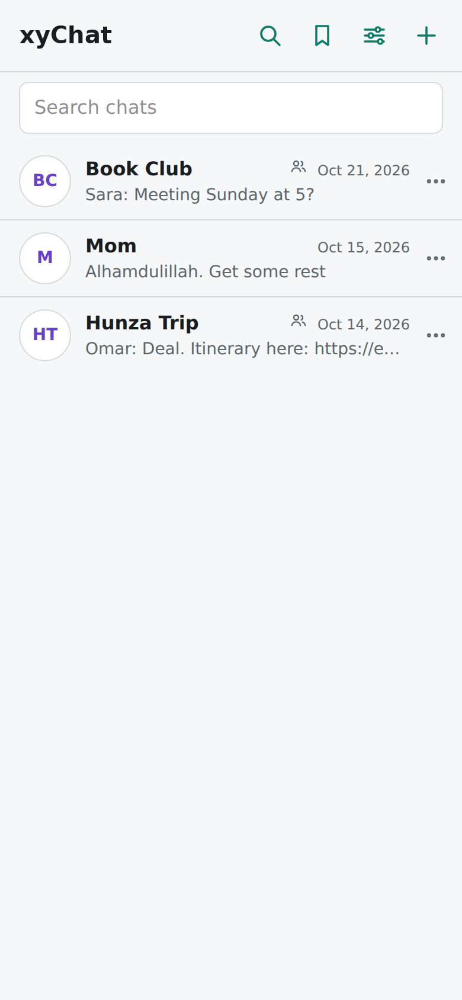
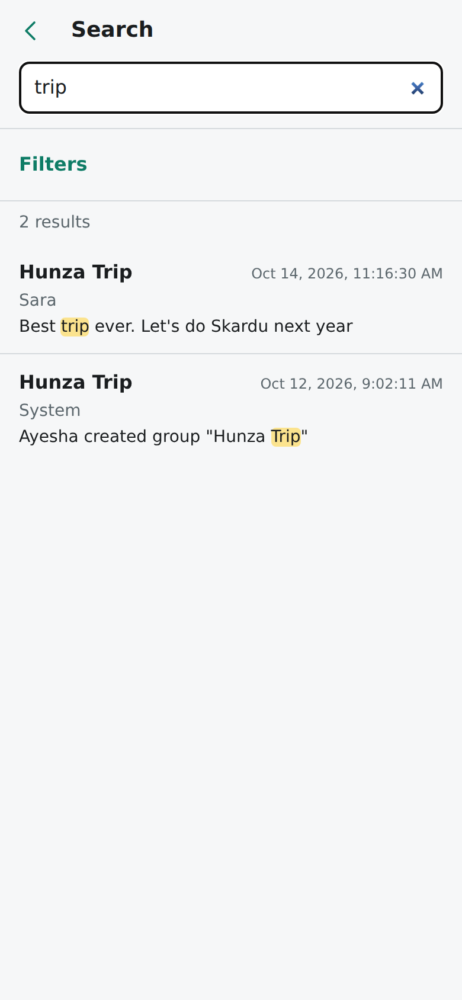
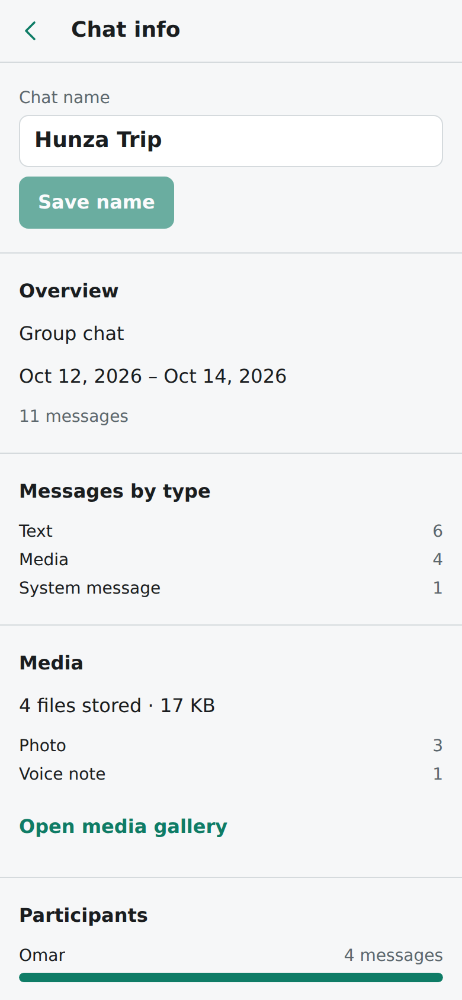

<p align="center">
  
</p>

<h1 align="center">xyChat</h1>

<p align="center">
  <strong>Your WhatsApp chat exports, readable forever: private, offline, on your own device.</strong>
</p>

<p align="center">
  <a href="https://github.com/hamza-kakar/xyChat/actions/workflows/ci.yml"></a>
  <a href="https://github.com/hamza-kakar/xyChat/releases/latest"></a>
  <a href="LICENSE"></a>
  
  
</p>

<p align="center">
  <a href="https://hamza-kakar.github.io/xyChat/"><strong>Open the app</strong></a> ·
  <a href="#try-it-with-a-demo-chat">Try the demo chat</a> ·
  <a href="#install-on-iphone">Install</a> ·
  <a href="#import-a-chat">Import a chat</a> ·
  <a href="#privacy">Privacy</a> ·
  <a href="#faq">FAQ</a>
</p>

xyChat is a viewer for chats exported with WhatsApp's **Export Chat**. Import
an export once and browse it in a familiar messaging layout: bubbles, photos,
voice notes, search and more, even years later and in airplane mode.

It is a Progressive Web App built for the iPhone Home Screen, and it also runs
in any current desktop or Android browser. There is no server and no account:
the database, media and search index all live in your browser's private
storage. **Your chats never leave your device.**

<div align="center">
<table>
  <tr>
    <td align="center">
      <picture>
        <source media="(prefers-color-scheme: dark)" srcset="docs/screenshots/readme/chats-dark.png">
        
      </picture>
      <br><sub>Chat list</sub>
    </td>
    <td align="center">
      <picture>
        <source media="(prefers-color-scheme: dark)" srcset="docs/screenshots/readme/chat-dark.png">
        
      </picture>
      <br><sub>Chat view</sub>
    </td>
    <td align="center">
      <picture>
        <source media="(prefers-color-scheme: dark)" srcset="docs/screenshots/readme/search-dark.png">
        
      </picture>
      <br><sub>Search</sub>
    </td>
  </tr>
  <tr>
    <td align="center">
      <picture>
        <source media="(prefers-color-scheme: dark)" srcset="docs/screenshots/readme/gallery-dark.png">
        
      </picture>
      <br><sub>Media gallery</sub>
    </td>
    <td align="center">
      <picture>
        <source media="(prefers-color-scheme: dark)" srcset="docs/screenshots/readme/info-dark.png">
        
      </picture>
      <br><sub>Chat info</sub>
    </td>
    <td></td>
  </tr>
</table>
</div>

<p align="center"><sub>Screenshots use a made-up demo chat. They follow your GitHub theme (light or dark).</sub></p>

## Highlights

- **Faithful reading.** Bubbles, day separators, sender colors in groups,
  WhatsApp text formatting (`*bold*`, `_italic_`, `~strike~`, `` `code` ``,
  quotes and lists), links, edited and deleted messages, polls, locations,
  contacts and calls.
- **All your media.** Photos with pinch-zoom, videos, documents, and voice
  notes with speed control, including `.opus` notes on iPhone.
- **Built for big chats.** Smooth scrolling through 100,000+ messages, fast
  full-text search in any script, jump to any date, bookmarks with notes.
- **Imports that just work.** iOS and Android exports, `.zip` with media or
  plain `.txt`, with automatic date and time format detection. Re-import a
  newer export and only the new messages are added.
- **Private by design.** No network requests for your data, no accounts, no
  analytics. An optional PIN hides the app, and its content stays out of the
  app switcher.
- **Yours to keep.** Backup and restore of your whole library (or one chat),
  with or without media, as a single file for Files or iCloud Drive.
- **Designed for everyone.** Light and dark themes, larger text sizes, screen
  reader labels, and right-to-left languages such as Urdu and Arabic. Every
  build runs automated accessibility checks; testing with VoiceOver on a real
  iPhone is still in progress.

## Try it with a demo chat

Want to see xyChat before importing your own chats? Use a made-up demo
export, a short group chat like the one in the screenshots, with photos, a
poll, a location, formatting and an edited message.

1. Download
   [WhatsApp Chat - Hunza Trip.zip](https://github.com/hamza-kakar/xyChat/raw/main/docs/demo/WhatsApp%20Chat%20-%20Hunza%20Trip.zip)
   (about 30 KB). On iPhone it goes to **Files → Downloads**.
2. Open xyChat, tap **+**, and choose the file.
3. Pick **Sam** as yourself and import.

## Install on iPhone

Requires iOS or iPadOS 17 or later.

1. Open <https://hamza-kakar.github.io/xyChat/> in **Safari**.
2. Tap **Share**, then **Add to Home Screen**, then **Add**.
3. Open xyChat from your Home Screen.

> [!IMPORTANT]
> Install to the Home Screen **before** importing. On iPhone, a Home Screen
> app has its own storage, separate from Safari tabs, and Safari can delete
> data stored in a tab.

On a computer or an Android phone, open the same address in a current browser
and use its **Install** option, or simply keep using it in a tab.

## Import a chat

1. In WhatsApp, open the chat and choose **Export Chat** (from the chat's info
   screen on iPhone, or ⋮ → More on Android).
2. Pick **Attach Media** to keep photos, videos and voice notes, or **Without
   Media** for text only.
3. Save the export to **Files** (iPhone) or your device storage.
4. In xyChat, tap **+**, choose the export, confirm the detected date
   format and which person is you, and start the import. Keep the app open
   until it finishes.

Exported the same chat again later? Import it the same way: only the new
messages are added, with no duplicates.

**Size limits:** the chat text can be up to 200 MB, each media file up to
2 GB, and a whole archive up to 20 GB (100,000 files). Large media archives
work; in practice your device's free storage is the real limit.

## Privacy

- **No network access for your data.** A strict Content Security Policy
  allows the app to load only its own files, and the service worker caches
  only the app's code for offline use.
- **Check it yourself.** After the first visit, turn on airplane mode: the app,
  your imported chats and search keep working, because nothing depends on a
  server.
- **No accounts, no cloud sync, no analytics, no crash reporting, no ads.**
- **The PIN is a privacy screen, not encryption.** Your phone's built-in
  storage encryption protects data at rest.
- **Backups are not encrypted.** A backup file holds your chats as they are,
  so keep it somewhere private.
- **Keep your original exports.** They are your primary backup and can always
  be imported again.

## Updates

The app updates itself in the background. When a new version is ready, an
**Update available** message offers **Reload**. Nothing reloads on its own,
and the message waits until any import, backup or restore has finished. To see
which version you’re running, open **Settings → Diagnostics**.

## Troubleshooting

<details>
<summary><strong>"This browser isn't supported" appears at startup, but it worked before</strong></summary>

This is a known issue: right after a quick relaunch or an update, the app can
start before the previous instance has released its storage, and it shows this
screen by mistake. Close xyChat completely (swipe it away in the app switcher)
and open it again. A fix is planned; see [Known issues](#known-issues).

</details>

<details>
<summary><strong>A bug I reported is still there after an update</strong></summary>

Your device may still be running the cached older version. Open **Settings →
Diagnostics** to check the version, and tap **Reload** when **Update available**
appears. If no message appears, close the app completely and open it again.

</details>

<details>
<summary><strong>An import fails or stops</strong></summary>

- Make sure the device has enough free storage for the export and its media.
- Keep xyChat open and in the foreground until the import finishes.
- If the export is a `.zip`, don't unzip it first; choose the `.zip` itself.
- If dates look wrong after an import, delete the chat and import it again,
  picking the other day and month order when asked.

</details>

<details>
<summary><strong>My chats disappeared</strong></summary>

On iPhone, a Home Screen app and a Safari tab have separate storage, so chats
imported in a tab don't show up in the installed app (and the other way
round). iOS can also clear a web app's storage when the device runs very low
on space. Import again from your original exports, or restore a backup from
**Settings → Backup and restore**.

</details>

## FAQ

**Does xyChat upload my chats anywhere?** No. There is no server. Everything
is stored and processed on your device, and the app's security policy blocks
network requests for your data.

**Does it work on Android or a computer?** Yes, in any current Chrome, Edge,
Firefox or Safari. It's tuned for the iPhone Home Screen, but the same app runs
everywhere.

**Can I import chats exported from Android on my iPhone?** Yes. Both iOS and
Android export formats are supported on every device.

**What happens if I delete the app?** Its storage is deleted with it, including
your imported chats. Keep your original exports or a backup file.

**Can it read my WhatsApp backup or connect to my account?** No. xyChat only
reads the files WhatsApp's **Export Chat** creates, and it never connects to
WhatsApp.

**Why are reactions and quoted replies missing?** WhatsApp's export doesn't
include them, so there is nothing to show.

## Limitations

- WhatsApp exports don't include reactions, quoted replies or read receipts,
  so xyChat can't show them.
- Exports carry no time zone; times are shown exactly as written.
- When an export's day and month order is ambiguous, the import asks you to
  choose.
- System messages and media placeholders are recognized in English. Chats
  exported from a phone in another language still import, but some events may
  appear as plain text.
- iOS may clear a web app's storage when the device is very low on space.
  xyChat requests persistent storage, but keep your exports or a backup.
- Backups over 1 GB may fail on iPhone memory limits; back up chat by chat
  instead.

## Known issues

- An intermittent "This browser isn't supported" screen at startup on iPhone
  (see [Troubleshooting](#troubleshooting)).
- The on-device test checklist in [docs/TESTING.md](docs/TESTING.md) has only
  been run in part on a real iPhone; automated end-to-end tests cover the same
  flows in Chromium and WebKit.

See [docs/ROADMAP.md](docs/ROADMAP.md) for known gaps and planned work.

## How it works

| Layer   | Technology                                                                       |
| ------- | -------------------------------------------------------------------------------- |
| UI      | React, React Router, TanStack Query and Virtual, Tailwind CSS                    |
| Storage | SQLite (WebAssembly) with FTS5 trigram search, in the Origin Private File System |
| Import  | A dedicated worker: streaming zip reader, parser, fingerprint-based merge        |
| Offline | A service worker that precaches the app; static hosting on GitHub Pages          |

The parser is pure TypeScript and covered by golden fixtures and
property-based tests. The whole app is checked with unit, browser and
end-to-end tests, accessibility audits, CSP checks and performance budgets on
every change.

## Development

```sh
pnpm install
pnpm dev         # development server
pnpm verify      # everything CI runs
```

Requires Node 24 or later and pnpm 12 or later (see `.nvmrc` and
`package.json`). The design specification is in [`docs/SPEC.md`](docs/SPEC.md),
decisions are recorded in [`docs/adr`](docs/adr), and
[`docs/ROADMAP.md`](docs/ROADMAP.md) lists what's next.

Contributions are welcome: see [CONTRIBUTING.md](CONTRIBUTING.md). To report a
security issue privately, see [SECURITY.md](SECURITY.md).

## License

MIT, see [LICENSE](LICENSE). The licenses of the bundled third-party packages
are listed in **Settings → About**. One of them, `codec-parser` (used by the
Opus voice-note fallback), is LGPL-3.0 and ships unmodified.

---

<sub>xyChat is an independent project. It is not affiliated with, endorsed
by or connected to WhatsApp or Meta. "WhatsApp" is a trademark of its owner
and is used here only to describe the export format this app reads.</sub>
